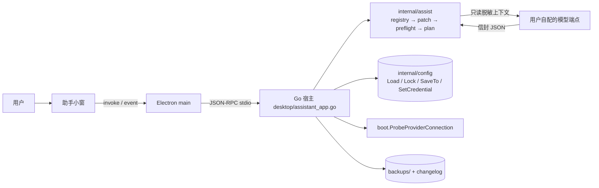

# Pondera 配置小助手（MVP / v1 规格）

## 结论

最高优先级不是 AI 或 UI，而是**受控写入器 + 字段注册表**。最大风险来自两处：

1. 桌面设置页以“整份 ProviderView 全量保存”，且有“已保存 / 待应用”两段语义；助手若绕开它直接写文件，会出现“助手改了、设置页一保存又覆盖回去”或“文件改了但运行中的会话没应用”的错觉。
2. 用户配置 `SaveTo` 会整份重渲染 TOML（注释丢失），与设置页行为一致，预览时必须提示。

主线：**唯一写入入口 + 共享文件锁 + 修订号校验 + diff 预览 + 备份回滚**，AI 只产出受限 patch。

## 形态

MVP 采用“同壳独立小窗”：现有 Electron 里第二个 BrowserWindow（独立路由、独立生命周期、托盘入口），复用宿主 Go 进程中的锁、原子写、凭据修订、探测与诊断。独立 exe 到 v1 再评估；TUI 作为同内核 headless 出口。

### 共用同一份配置的并发保护

- 写入一律经 `config.LockConfigFilesEdits(userConfigPath, credentialPath)` 作为一次事务加锁（内部按路径排序，避免死锁）。
- 加锁后重新严格读取，不信任预览时的内存快照。
- 预览时记录 `configHash(raw bytes) + CredentialStoreRevision()`；落盘前比对，不一致返回 `stale_plan`（禁止按旧快照覆盖）。
- 写成功广播 `assistant:config-changed`；桌面设置页收到后重新加载并提示未保存草稿。
- 锁 5s 超时 → 提示另一进程正在保存配置，提供重试，不自动重试写盘。

## 架构



硬规则：UI 不碰文件；模型只看到脱敏后的白名单字段；模型只能输出信封 JSON；落盘只经 `internal/assist/writer`。

## 配置字段注册表

两层：

1. **反射审计层**（测试）：遍历 `Config` 全部 `toml` tag，断言每个字段都有注册表条目，或位于被标记的 denied 分组。struct 漂移即测试失败。
2. **注册表**：`path / type / scope / enum / min-max / default / sensitive / writable / risk(benign|confirm|deny) / doc`。

### 顶层分组与敏感字段

| 分组 | 说明 | 敏感 | MVP 可写 |
|---|---|---|---|
| 顶层 | `default_model`、`language`、`config_version` | 否 | `default_model` |
| `providers[]` | 连接与模型 | `api_key_env`、`headers`、`extra_body` | `model/default/context_window/max_output_tokens/effort` |
| `agent` | 温度、压缩、重试、各类模型引用 | 否 | `temperature/compact_ratio/retry_count/planner_model/subagent_model/vision_model/web_search_model` |
| `serve` / `bot` / `network` / `sandbox` / `permissions` / `secrets` / `plugins` / `statusline` | 安全边界或可执行项 | `serve.token/password_hash`、`bot.*_env`、`network.proxy.password` | 仅解释 |
| 其余 | ui/desktop/billing/notifications/tools/skills/lsp/browser/remote/checkpoints/environment/attachments | — | 只读 |

敏感值统一脱敏展示：`已设置（长度 N，末尾 …abcd）` / `未设置`；不进入模型上下文、日志与 UI 原文。

## 安全写入链路

```
plan ─▶ ①严格只读 ─▶ ②schema+跨字段校验 ─▶ 预览(diff+脱敏)
                                                │ 确认
                                                ▼
     ③加锁(config+.env) ─▶ ④重新严格读 ─▶ ⑤修订号比对
                                                │ 一致
                                                ▼
     ⑥备份原始字节 ─▶ ⑦apply typed patch ─▶ ⑧SaveTo + SetCredential
                                                ▼
     ⑨重新加载断言 ─▶ 成功记录 changelog；失败按 ⑥ 自动回滚
```

- 备份：`%AppData%\pondera\assistant\backups\<ts>-<hash>/`（0600）+ `manifest.json`（patch、预期值、脱敏 diff）；保留最近 10 份、30 天。
- 原子写只用 `fileutil.AtomicWriteFile`；绝不 `os.WriteFile` 配置。
- 密钥只走 `config.SetCredential`，绝不自行写 `.env`。
- 写后校验失败 → 用备份恢复；严格读取失败 → 拒绝写入，提供备份恢复。
- MVP 不写项目 `pondera.toml`，只读并解释覆盖关系。

## Patch DSL（MVP 三个 op）

信封：

```json
{
  "version": 1,
  "intent": "把默认模型换成 deepseek-v4-pro",
  "reply": "我会修改 1 项",
  "ops": [
    { "op": "set", "path": "default_model", "value": "deepseek/deepseek-v4-pro" },
    { "op": "set_provider_field", "provider": "deepseek", "field": "context_window", "value": 1000000 },
    { "op": "set_secret", "api_key_env": "DEEPSEEK_API_KEY", "value": "sk-..." }
  ]
}
```

| op | 参数 |
|---|---|
| `set` | 白名单标量路径 + 标量值 |
| `set_provider_field` | provider 名称 + 白名单字段 + 标量值 |
| `set_secret` | 被某 provider 引用的环境变量名 + 值 |

拒绝规则：

1. 未知路径 / 非标量数组表 → `unknown_path` / `type_mismatch`
2. 越界：`retry_count 0–1000`、`compact_ratio 0.5–0.95`、`temperature 0–2`、`context_window ≥1000`、`max_output_tokens ≥0`
3. `default_model` 必须解析到已存在 provider/model
4. `api_key_env` 必须形如 `[A-Z][A-Z0-9_]*` 且被 provider 引用
5. 命中敏感组（serve/bot/network/sandbox/permissions/secrets/plugins/statusline）→ `denied_by_policy`
6. 信封多余字段、整份 TOML/JSON、路径、命令 → 拒绝
7. 一次 ≤10 个 op；`intent` ≤200 字；重复应用返回 `stale_plan`

## 问答与诊断

10 项诊断：`config_parse_error`、`credential_missing`、`credential_unused`、`provider_unregistered`、`model_missing`、`endpoint_mismatch`、`duplicate_provider`、`project_shadow`、`compact_disabled`、`retry_out_of_range`。

连通测试复用 `boot.ProbeProviderConnection`（≤20s），结果分类 401/403/404/429/timeout/DNS/TLS。

## 交互

- 首次：选预设或自定义 → `endpoint + key + model` → 测试连接 → 保存到 `%AppData%\pondera\assistant\`。失败保留草稿，允许“仍然保存（未验证）”。
- 日常：自然语言 → patch → 预览卡（人话 diff、风险徽标、脱敏、注释丢失提示）→ 确认 → 写入 → “已保存 / 已应用 / 应用失败重试” → 可撤销。
- 失败态：锁占用、`stale_plan`、配置损坏、写后校验失败、桌面应用失败、助手端点不可用（仍可本地诊断）。

## 落点

```
internal/assist/registry/   registry.go schema.go snapshot.go registry_test.go
internal/assist/patch/      parse.go validate.go diff.go plan.go patch_test.go
internal/assist/writer/     writer.go writer_test.go
internal/assist/diagnose/   diagnose.go
internal/assist/engine/     client.go prompt.go
internal/assist/store/      store.go
internal/assist/            assistant.go assistant_test.go
desktop/assistant_app.go
desktop/electron/src/main/assistantWindow.ts
desktop/frontend/src/assistant/*
```

助手自身配置独立存放，不并入主配置；助手密钥经 `SetCredential` 写入主凭据库的独立变量名。

### MVP 实现现状（与上方规格的两处有意偏差）

1. **加锁范围**：写入器只调用 `config.LockConfigFilesEdits(userConfigPath)`；`.env` 由 `SetCredentialIfRevision` 在自身锁内写入，避免“持锁再调用 `SetCredential`”的死锁。凭据修订号仍参与预览前比对与写入后校验，不一致按 `stale_plan` 回滚。
2. **不做设置页广播**：MVP 不发送 `assistant:config-changed`（避免与设置页插件页签的并行改动冲突）。设置页在自身保存时仍会以“整份保存”覆盖助手结果，但写入前的修订号比对会阻止助手基于旧快照覆盖新内容。广播留到 v1。

## 分阶段

### MVP

独立小窗、onboarding、三类写入（默认模型、provider 标量、agent 标量/模型引用）、只读解释；完整安全链路。

验收：

- 并发：助手与整份保存路径同秒写 ×100，文件始终完整可解析
- 崩溃：写盘中途杀进程，原文件完整
- 越权：12 类非法 patch 全部拒绝且理由可读
- 脱敏：UI、日志、模型请求体不含 secret 原文
- 回滚：还原后 hash 等于备份
- 生效：改 `default_model` 只影响新会话
- 幂等：同 patch 二次应用为 no-op 或 `stale_plan`

### v1

诊断 10 项 + 连通测试 + 回滚历史 + `add_provider` / `remove_provider`（未知域名二次确认）+ 项目覆盖解释 + `pondera assistant` headless 出口 + 注释保留式定点改写 + 独立进程/托盘。

### 明确不做

- 模型输出整份配置覆盖写盘
- 自行写 `.env`
- MVP 写项目 `pondera.toml`
- 触碰安全/可执行配置组
- 无显式确认自动应用
- 后台自动调参、遥测、更新上报
- 执行 shell 或访问配置目录之外路径
